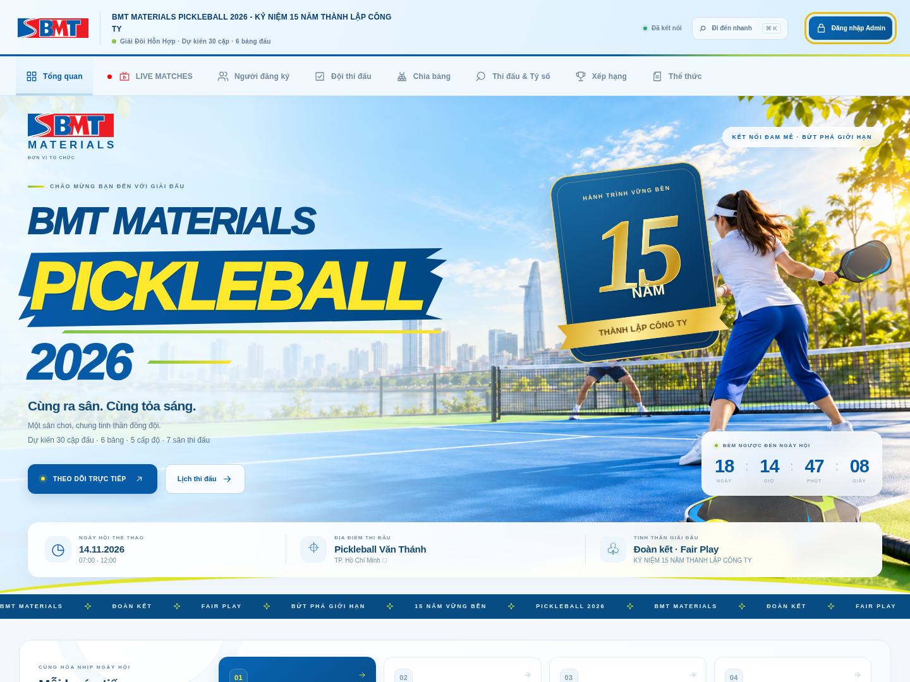

# BMT Materials Pickleball 2026 — GIẢI MỚI, DỮ LIỆU TRỐNG

Giao diện BMT tràn viền theo logo `docs/RENEW.pdf` và phong cách poster đã duyệt. Giữ logic giải 6 bảng A–F × 5 level A–E, dự kiến 30 cặp/60 VĐV, 7 sân; lịch vòng tròn 75 trận được tạo khi xếp đội. Ngày dự kiến 14/11/2026, 07:00–12:00, Pickleball Văn Thánh.

**Bản bàn giao không có VĐV, đội, bảng đã xếp, trận đấu đã lưu, tỷ số, ghi chú, lịch sử LIVE hoặc tài khoản của giải trước.** Không kèm database cũ, bản sao lưu cũ, ảnh/logo đội cũ hoặc node_modules. Các ký hiệu A–F, level, luật và khuôn lịch là cấu hình, không phải kết quả/dữ liệu thi đấu.

## Xem giao diện



[Xem giao diện điện thoại](docs/screenshots/overview-mobile.png)

## Cài mới

Dùng Node.js 22 (khuyến nghị 22.23.4, xem `.nvmrc`). Trên GitHub bấm **Code → Download ZIP**, giải nén rồi mở terminal trong thư mục có `package.json` (thường là `Pickleball-main`). Nếu dùng `git clone`, thư mục là `Pickleball` như lệnh dưới. Cài mới vào **thư mục mới**, không chép chồng database của giải trước.

```bash
cd Pickleball
npm ci
npm start
```

Server mặc định cổng 4000. Có thể đặt `PORT` và `TOURNAMENT_DB_PATH` nếu cần đường dẫn database riêng. Lần chạy đầu tự tạo schema SQLite, metadata giải và hai tài khoản khởi tạo; **không cần chạy seed**.

| Tài khoản mới | Mật khẩu khởi tạo | Quyền |
|---|---|---|
| admin | admin123 | Quản trị |
| user | user123 | Chỉ xem |

Đăng nhập Admin → **Quản lý người dùng** → **Đổi mật khẩu** để đổi mật khẩu khởi tạo trước khi dùng thật. Sau khi đặt lại mật khẩu của tài khoản đang đăng nhập, đăng nhập lại. Tài khoản này được tạo mới, không giữ user/hash/token của giải cũ.

## UI/UX & tương tác

- Banner tràn viền, VĐV nữ mặc quần thể thao phủ gối; huy hiệu 15 năm vàng nổi bật trên nền xanh đậm. Header trắng–xanh nhạt cùng nhận diện, countdown và dải chuyển động.
- Lộ trình 4 bước từ đăng ký đến ra sân; thống kê thật, không nạp dữ liệu giả.
- Menu icon với thanh chọn chuyển động; dùng phím mũi tên để chuyển tab, hoặc **Ctrl/Cmd + K** để tìm trang nhanh không dấu.
- Card xuất hiện khi cuộn, phản hồi nút/ripple, chuyển tab, modal/toast và nhấn mạnh tỷ số mới lưu. Tôn trọng **Reduce Motion** của thiết bị.
- Modal giữ focus bàn phím, hỗ trợ Escape; đăng nhập có hiện/ẩn mật khẩu và hướng dẫn khôi phục Admin.
- Tối ưu desktop/tablet/điện thoại. Giữ bảng có thể cuộn để nhập và đọc số liệu rõ ràng.

## Tạo giải từ đầu

1. Tab **Người đăng ký**: thêm VĐV và level. Hoặc tab **Đội thi đấu**: thêm trực tiếp một cặp.
2. Tab **Đội thi đấu**: tự ghép theo level hoặc ghép tay. Người đã có cặp không bị ghép lại; người lẻ chờ BTC xử lý.
3. Tab **Chia bảng**: xếp đủ 30 ô (6 bảng × 5 level), mỗi ô một cặp, sau đó bấm **Bắt đầu thi đấu**.
4. Tab **Thi đấu & Tỷ số**: nhập và lưu điểm. Luật giữ nguyên: chạm 11, cách biệt 2, trần 15; thắng 1 điểm, thua 0, không hòa.
5. Tab **LIVE MATCHES**: tự nhận đúng đội/VĐV/sân khi Admin bắt đầu nhập điểm ở **Thi đấu & Tỷ số**. Điểm đang gõ được phát realtime cho màn hình xem; chỉ khi lưu kết quả hợp lệ mới chuyển Finished và tính xếp hạng. Mỗi sân hiển thị một trận hiện hành; nhập trận khác cùng sân sẽ chuyển sang trận đó. Có nút **Nhập điểm** để quay về đúng ô, và **Nhập tay** nếu BTC muốn tùy chỉnh. Khi nhập điểm từ lịch trở lại, tự đồng bộ được bật lại.
6. Xem **Xếp hạng**, xuất JSON để sao lưu, xuất Excel chia bảng/lịch khi cần.

Tiêu đề “dự kiến 30 cặp” là quy mô mục tiêu, không có nghĩa hệ thống đã nạp 30 cặp mẫu. Chỉ tiêu thống kê ban đầu đều bằng 0.

## Reset khi chủ động tạo một giải khác

- **Tạo lại giải** ở header: xóa VĐV, đội, các ô đã xếp, lịch/tỷ số/ghi chú và LIVE; về trạng thái đang chuẩn bị. Giữ tài khoản quản trị hiện tại.
- **Khôi phục** ở tab Chia bảng: chỉ mở khóa việc xếp bảng và xóa tỷ số; giữ đội/VĐV. Hai thao tác khác nhau.
- Lệnh reset cũng **giữ nguyên toàn bộ user, quyền và mật khẩu**. Khi chủ động tạo lại giải bằng terminal, dừng server rồi chạy:

```bash
npm run reset -- --confirm
npm start
```

Không có tùy chọn xóa tài khoản trong lệnh reset. Không chạy reset mỗi lần khởi động. `npm run seed` chỉ khởi tạo metadata nếu cần; **không nạp demo, không xóa dữ liệu đã nhập**.

### Nếu không đăng nhập được Admin

Cài mới vào thư mục trống: tài khoản `admin`, mật khẩu khởi tạo `admin123`. Nếu dùng database đang có, mật khẩu cũ của tài khoản được giữ nguyên.

Khi quên mật khẩu hoặc bị mất quyền Admin, người quản lý máy chủ dừng server, mở terminal tại thư mục source rồi chạy:

```bash
npm run admin:recover
npm start
```

Công cụ hỏi tên tài khoản và mật khẩu mới (ít nhất 8 ký tự, không hiển thị khi gõ). Chỉ sửa/tạo tài khoản được chọn, **không thay đổi dữ liệu giải**. Sau khi khởi động lại server, đăng nhập bằng mật khẩu vừa đặt. Không có endpoint reset Admin công khai. Tự động hóa có thể cung cấp `BMT_ADMIN_USERNAME` và `BMT_ADMIN_PASSWORD` qua biến môi trường riêng; không ghi mật khẩu vào source/Git.

Có hướng dẫn ngay trên màn hình đăng nhập tại [trang hỗ trợ Admin](public/admin-help.html).

Namespace localStorage đã tách cho giải mới; khi mở bản mới, chỉ ba khóa cache/phiên của ứng dụng giải trước được loại bỏ. Không đọc hoặc di chuyển VĐV cũ vào giải mới; không đụng tới bộ nhớ không liên quan của website.

## LIVE tự động và màn hình trình chiếu

Mở tab LIVE trên máy chiếu hoặc một trình duyệt khác. Khi BTC focus/nhập vào ô điểm của trận chưa kết thúc, sân tương ứng nhận đúng trận, tên bảng, logo và hai VĐV. Điểm dở dang như 3–3 hay 11–10 được hiển thị trực tiếp nhưng **không** trở thành kết quả chính thức. Lưu 11–9 hợp lệ sẽ chuyển Finished và cập nhật xếp hạng.

Luồng realtime dùng Server-Sent Events (`/api/events`), có reconnect và polling dự phòng. Điểm phát được lưu riêng trong `live_scores`, không làm xung đột phiên bản dữ liệu của các Admin đang nhập ở sân khác. Bản nhập đến trễ không được ghi đè kết quả đã lưu. F5 vẫn lấy lại điểm đang phát để tiếp tục nhập.

**Nhập tay** lưu thông tin do BTC chọn và tắt liên kết của sân đó; một trận khác đang phát sẽ không bị xóa bởi yêu cầu chuyển chế độ đã cũ. Reset giải hoặc về lại giai đoạn xếp bảng sẽ xóa liên kết tự động; tài khoản vẫn được giữ nguyên. JSON import phục hồi dữ liệu thi đấu chính thức và LIVE nhập tay; luồng điểm dở dang sẽ được phát lại khi BTC tiếp tục nhập.

Sau khi cập nhật source, **khởi động lại Node server** để có API LIVE mới. Nếu dùng Nginx/reverse proxy, tắt buffering cho `/api/events` và cho phép giữ kết nối; server đã gửi `X-Accel-Buffering: no` và heartbeat.

## Lưu và đồng bộ

SQLite lưu tại `data/tournament.db` mặc định. Hệ thống gửi phiên bản dữ liệu khi lưu, xử lý tuần tự các bản lưu và từ chối xung đột 409. Chỉ báo **Đã lưu** khi server xác nhận. Khi lỗi tạm thời, bấm **Lưu lại**. Khi có xung đột/quyền thay đổi, xuất JSON để giữ bản sao thay đổi trước khi tải lại; không tự ghi đè dữ liệu Admin khác.

Thông báo thành công của thao tác chỉnh sửa xuất hiện trước khi lần lưu mạng kết thúc; xem thêm trạng thái lưu ở header để biết dữ liệu đã lên server hay chưa.

Đóng tab/đăng xuất khi còn bản lưu chờ sẽ được xử lý để tránh mất dữ liệu. Token và quyền được kiểm tra lại trên server; thay đổi quyền/xóa tài khoản có hiệu lực ngay. Lỗi kết nối đăng nhập HTTP không chuyển sang tài khoản demo local.

## Kiểm tra

```bash
npm test
npm audit
```

Test dùng dữ liệu giả sinh trong `tests/` và database tạm riêng, không nạp dữ liệu test vào giải thật. Xem [báo cáo rà soát](REVIEW-REPORT.md) cho phạm vi và kết quả.

## Các thành phần

- `server.js`, `auth.js`, `db.js`: Express API, quyền, SQLite transaction và SSE.
- `live-store.js`, `public/live-sync.js`: lưu/phát điểm đang nhập, tách khỏi kết quả chính thức.
- `public/tournament.js`: cấu hình giải, trạng thái trống và validation dùng chung.
- `public/schedule.js`: khuôn ghép trận theo bảng/level, không chứa VĐV/kết quả.
- `public/app*.js`: CRUD VĐV/đội, bảng, điểm, xếp hạng, LIVE và lưu/đồng bộ.
- `public/brand-theme.css`, `public/experience.css`, `public/ui.js`, `public/assets/`: nhận diện BMT, giao diện, tương tác và chuyển động.
- `recover-admin.js`: khôi phục quyền/mật khẩu qua terminal của máy chủ, không xóa giải.
- `public/vendor/`: ExcelJS 4.4.0 cục bộ cùng giấy phép MIT, không cần CDN.
- `migrate-schedule.js`: công cụ thủ công để đổi sang khuôn lịch hiện tại; không chạy tự động. Nếu dùng cho một giải đang có dữ liệu, sao lưu SQLite và dừng server trước.

Giao diện chính cần chạy qua Express. Cơ chế file/localStorage cũ vẫn có để dự phòng/mô phỏng; không dùng mở file HTML trực tiếp để vận hành giải nhiều máy.
